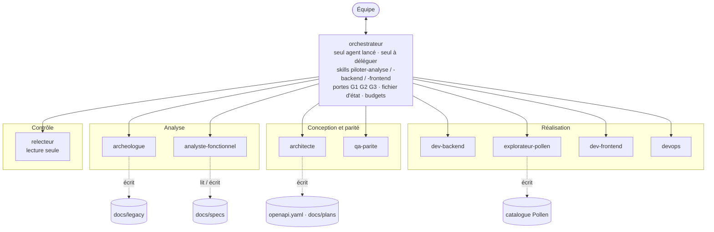
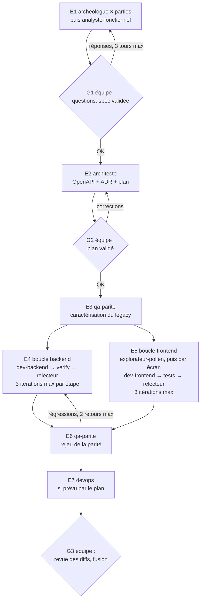
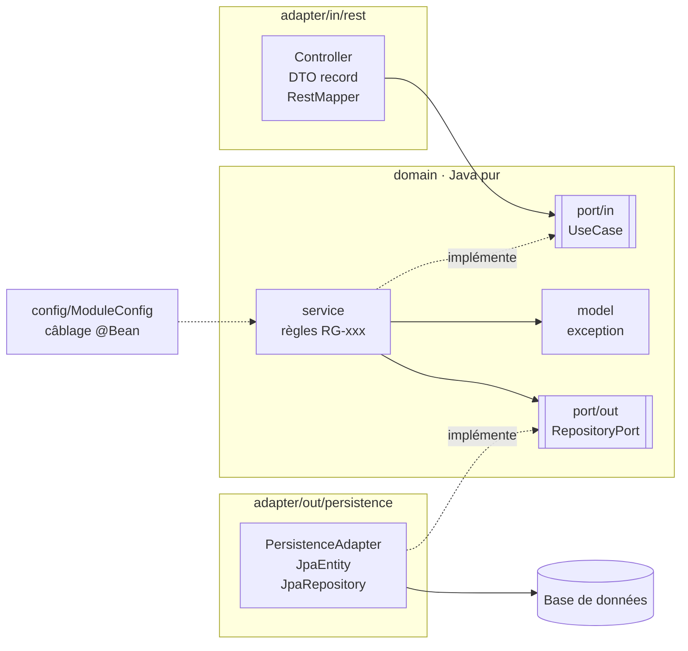

# Kit Mistral Vibe : refonte de l'outil de recette

Ce kit configure **Mistral Vibe** pour refondre l'outil de recette :
Java/JSP legacy → **Java 21 / Spring Boot en architecture hexagonale (100 % de couverture)**
+ **Angular 22 avec Pollen**, déployés en **Docker / Kubernetes**.

**Un seul agent à lancer : l'orchestrateur.** Dans Vibe, un subagent ne peut pas lancer de subagent :
l'orchestrateur délègue donc directement à 9 subagents spécialisés. Il porte lui-même les boucles
(implémentation → vérification → relecture) grâce à des skills de pilotage, avec des budgets bornés et
trois portes de validation humaine.

## Organisation sur le poste

```
C:\Local\Git\
├── AGENTS.md                 ← kit : contexte commun (installé par le script)
├── .vibe\                    ← kit : config, agents, prompts, skills
├── Outil-recette\            legacy Java/JSP            (lecture seule)
├── outil-recette-api\        backend cible              (+ AGENTS.md, docs\, api\openapi.yaml)
├── outil-recette-webapp\     frontend cible             (+ AGENTS.md, docs\pollen\catalogue.md)
└── <projet-reference-pollen>\  exemple d'usage de Pollen (lecture seule)
```

**On lance toujours `vibe` depuis `C:\Local\Git\`** : les agents voient ainsi les trois repos.
Chaque repo cible a son propre `AGENTS.md`, chargé dès qu'un agent y lit des fichiers.
Les artefacts transverses (cartographie, specs, ADR, plans, état et suivi, contrat OpenAPI) sont
versionnés dans `outil-recette-api`.

## Contenu du kit

```
installer.ps1                         Script d'installation sur le poste
workspace/AGENTS.md                   → C:\Local\Git\AGENTS.md
workspace/.vibe/config.toml           Agent par défaut = orchestrateur, limites de subagents, garde-fous
workspace/.vibe/agents/*.toml         1 agent (orchestrateur) + 9 subagents
workspace/.vibe/prompts/*.md          Prompts système
workspace/.vibe/skills/*/SKILL.md     17 skills : protocole, 3 skills de pilotage, 13 skills métier
repos/outil-recette-api/              AGENTS.md backend, squelette docs/, modèle de fichier d'état
repos/outil-recette-webapp/           AGENTS.md frontend, modèle de catalogue Pollen
```

## Installation

```powershell
.\installer.ps1 -PaquetPollen "<nom npm de Pollen>" -ProjetReferencePollen "<dossier du projet de référence>"
```

- `-Simulation` montre ce qui serait fait sans rien écrire. `-Racine` change le dossier (par défaut `C:\Local\Git`).
- `AGENTS.md` et `.vibe\` du workspace sont **remplacés** (l'existant est sauvegardé dans `.vibe-sauvegarde-<date>`).
- Dans les repos cibles, les fichiers déjà présents ne sont **jamais écrasés**. Le legacy n'est jamais touché.

Puis :
1. `cd C:\Local\Git` puis `vibe`, et **marquer le dossier comme trusted** (sinon `.vibe/` n'est pas chargé).
2. Vérifier que l'agent actif est bien « Orchestrateur de migration ».
3. Lancer `npm --prefix outil-recette-webapp ci` pour que les typages de Pollen soient dans `node_modules`.
4. Compléter les `AGENTS.md` : commandes du legacy, base de données, contraintes de la plateforme Kubernetes.
5. Commiter les fichiers ajoutés dans `outil-recette-api` et `outil-recette-webapp`.

## Schéma 1 : l'orchestrateur et ses subagents



Délégation **en étoile, sur un seul niveau** : aucun subagent ne délègue, donc aucun cycle n'est possible.
Les subagents se passent leurs livrables **par fichiers** (cartographie, spec, plan, catalogue), pas par
l'orchestrateur, ce qui garde son contexte léger. Seul l'orchestrateur parle à l'humain : un subagent qui a
besoin d'une décision rend `BLOQUE` avec sa question.

## Schéma 2 : déroulé d'une tranche et boucles bornées



## Comment les boucles sont bornées

| Mécanisme | Où |
|---|---|
| Délégation sur un seul niveau (limite de Vibe) : aucun cycle possible | Vibe, skill `protocole-orchestration` |
| Les boucles sont portées par l'orchestrateur, qui vérifie lui-même (`mvn -q verify`, tests, build) | skills `piloter-analyse`, `piloter-backend`, `piloter-frontend` |
| Budgets par boucle : 3 itérations par étape back et par écran front, 3 tentatives par échec, 3 tours de questions, 2 retours parité, 1 relance après `ECHEC` | skill `protocole-orchestration` |
| Budget global : 40 délégations par tranche | skill `protocole-orchestration` |
| Arrêt immédiat en cas de non-progrès (même échec deux fois, aucun fichier modifié, mêmes remarques) | skill `protocole-orchestration` |
| Aucun subagent n'attend l'humain : retour `BLOQUE` au lieu d'une question | prompts, `permission = "never"` sur les commandes non listées |
| Retour standardisé `STATUT: OK / A_CORRIGER / BLOQUE / ECHEC` | skill `protocole-orchestration` |
| Compteurs et étape courante persistés, reprise après interruption | `outil-recette-api/docs/migration/etat/<module>.md` |
| 2 subagents simultanés maximum, un seul écrivain par repo | `max_concurrent_subagents = 2`, protocole |

> Vibe ne propose pas de limite de tours par agent : les budgets sont appliqués par les prompts et
> comptés dans le fichier d'état. Relisez-le pendant les premières tranches pour vérifier qu'ils sont respectés.

## Schéma 3 : architecture hexagonale d'un module backend



## Agents

| Agent | Type | Étape | Écrit dans | Rôle |
|---|---|---|---|---|
| `orchestrateur` | agent | toutes | fichier d'état, suivi | Pilote la tranche, boucles, portes humaines, budgets |
| `archeologue` | subagent | E1 | `docs/legacy/<module>/<partie>.md` | Cartographie d'une partie du legacy |
| `analyste-fonctionnel` | subagent | E1, G1 | `docs/legacy/<module>.md`, `docs/specs/` | Fusion des cartographies, spec, questions |
| `architecte` | subagent | E2 | `api/openapi.yaml`, `docs/adr/`, `docs/plans/` | Contrat, ADR, plan de tranche |
| `qa-parite` | subagent | E3, E6 | `src/test/.../parite/` | Caractérisation puis rejeu de la parité |
| `dev-backend` | subagent | E4 | outil-recette-api | Code hexagonal + tests |
| `explorateur-pollen` | subagent | E5 | catalogue Pollen | Usage des composants Pollen |
| `dev-frontend` | subagent | E5 | outil-recette-webapp | Écrans Angular + Pollen + tests |
| `relecteur` | subagent | E4, E5 | rien (lecture seule) | Revue selon la checklist |
| `devops` | subagent | E7 | Dockerfile, charts | Docker et Helm, sans jamais déployer |

## Skills

| Skill | Utilisée par | Pour |
|---|---|---|
| `protocole-orchestration` | tous | Délégation à un niveau, budgets, non-progrès, brief, format de retour, état |
| `piloter-analyse` | orchestrateur | E1 + G1 : découpage, archeologue × parties, analyste, tours de questions |
| `piloter-backend` | orchestrateur | E4 : boucle dev-backend → verify → relecteur |
| `piloter-frontend` | orchestrateur | E5 : catalogue Pollen, puis boucle dev-frontend → tests → relecteur |
| `cartographier-module-legacy` | archeologue, analyste-fonctionnel | Rétro-documenter un module legacy |
| `extraire-regles-metier` | archeologue, analyste-fonctionnel | Produire la spec et les règles RG-xxx |
| `rediger-adr` | architecte | Décisions d'architecture |
| `structurer-module-hexagonal` | architecte, dev-backend, relecteur | Arborescence, nommage, règles ArchUnit |
| `ecrire-test-caracterisation` | qa-parite | Figer le legacy et mesurer la parité |
| `migrer-servlet-vers-rest` | architecte, dev-backend | Servlet → cas d'usage + adapter REST |
| `migrer-acces-donnees` | dev-backend | DAO / JDBC → adapter de persistance + Flyway |
| `atteindre-couverture-100` | dev-backend | Combler les trous JaCoCo avec des tests utiles |
| `cataloguer-pollen` | explorateur-pollen | Catalogue Pollen (node_modules + projet de référence) |
| `migrer-ecran-jsp` | dev-frontend | JSP → composant Angular 22 avec Pollen |
| `dockeriser-service` | devops | Dockerfiles api et webapp |
| `deployer-k8s` | devops | Charts Helm et validation à blanc |
| `checklist-migration` | orchestrateur, qa-parite, relecteur | Critères de fin de tranche |

Les skills restent invocables à la main (`/<nom>`) si vous voulez faire une étape hors orchestration.

## Pollen : comment les agents l'apprennent

Pollen n'est connu d'aucun modèle. Le kit s'appuie sur trois sources, par ordre de fiabilité :
1. **Les typages `.d.ts` du paquet dans `outil-recette-webapp/node_modules/`**, présents dès que
   `npm ci` a tourné sur le poste pro.
2. **Le catalogue `outil-recette-webapp/docs/pollen/catalogue.md`**, complété par `explorateur-pollen`
   à la demande de l'orchestrateur, et relu par l'équipe.
3. **Le projet de référence**, en lecture seule, pour des exemples d'usage réels.

## Utilisation

```
cd C:\Local\Git
vibe
> Migre le module <nom du module>.
```

L'orchestrateur crée le fichier d'état, enchaîne les étapes et s'arrête à chaque porte (G1, G2, G3)
ou quand un budget est atteint. Pour reprendre plus tard : « Reprends la tranche <module> ».

**Phase 0, une fois au début** : « Prépare le socle : ADR transverses (cohabitation legacy, authentification,
base de données) et squelette hexagonal de outil-recette-api avec ArchUnit et JaCoCo à 100 %. »

**Commencez par un petit module pilote**, relisez le fichier d'état et les retours des subagents, puis
ajustez les budgets, les prompts et les skills avant de passer aux autres modules.

## Bonnes pratiques

- Relisez chaque diff. Les agents proposent, l'équipe décide et fusionne.
- Quand un agent répète une erreur, corrigez son prompt, la skill concernée ou l'`AGENTS.md`.
- Si une boucle bute souvent sur son budget, le brief ou la spec est probablement flou : clarifiez-les plutôt que d'augmenter le budget.
- N'utilisez `auto-approve` que dans un conteneur jetable.
